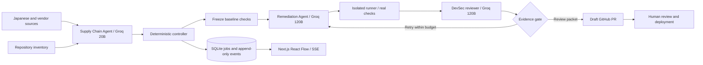

# ProofPatch end-to-end hackathon plan

Status: initial system-design plan, with the first bounded vertical flow implemented and executed on 24 October 2026 UTC. Live Japanese intake, actual Groq roles, persisted progress, frozen hosted PHP checks and automatic [draft PR #3](https://github.com/Harsh5840/arigato-php-demo/pull/3) work. [Current evidence](IMPLEMENTATION-HANDOFF.md) supersedes planned behavior below; [LIVE-DEMO.md](LIVE-DEMO.md) is the runbook. Broader phases remain proposals.

## The output judges can inspect

The proposed demo follows a Japanese advisory into a fictional Japanese SME's repository and ends with a real draft pull request. SakuraShop uses PHP 8.3.35. ProofPatch finds the affected runtime, proposes PHP 8.3.36, runs scoped checks, and presents the evidence for human review. A separate configuration follow-up remains open.

The product repository is `Harsh5840/arigato-hack`. The separate demonstration target `Harsh5840/arigato-php-demo` has now been created, with a [prepared draft repair PR](https://github.com/Harsh5840/arigato-php-demo/pull/1). That foundation PR does not come from live Groq orchestration. Keep demo application code separate from the product so judges can inspect the PR as a customer's artifact. Current publication/evidence status is in [the handoff](IMPLEMENTATION-HANDOFF.md).

The Japan connection is functional: live JPCERT/CC intake and PHP corroboration preserve source links/timestamps/digests, actual Groq calls explain impact in Japanese and English, and hosted checks test a Japanese storefront. JVN expansion remains planned. The implementation retains a normalized factual brief rather than reproducing entire advisory pages.

## Three agents and a deterministic controller

| Component | Owns | Output and permission boundary |
|---|---|---|
| Supply Chain Agent | Feed triage, advisory deduplication, runtime and package inventory matching, bilingual explanation | Source-backed risk brief. Read-only access to approved sources and repository inventory. Cannot edit code. |
| Remediation Agent | Compatible runtime update and scoped code changes | Candidate diff, rationale, and rollback plan. Write only to an isolated candidate branch. Cannot edit the frozen checks or merge. |
| Development Security Agent | Local-change checks, candidate tests, senior engineering review | Check results and review disposition against the exact commit. Cannot write candidate code or redefine expected behavior. |
| Controller | State transitions, permissions, budgets, retries, queue, PR eligibility | Deterministic decisions and audit events. It is infrastructure, not a fourth LLM agent. |

For the first demo, the local-change trigger is a manual run or Git push webhook. A persistent filesystem watcher and broad autonomous pentesting are later work. The DevSec agent uses bounded tests against the owned fixture, not arbitrary internet targets.

Use Groq's real models: `openai/gpt-oss-20b` for Supply Chain and `openai/gpt-oss-120b` for Remediation and DevSec review. These are listed production models. Groq's standard catalog does not list Claude Sonnet or Opus. The UI must show the actual provider and model ID. A second 120B pass has a different role and context, but it is not independent model verification. [Groq models](https://console.groq.com/docs/models)

Model IDs belong in server environment configuration. At startup, discover them through authenticated `GET https://api.groq.com/openai/v1/models` and check selected-model availability. An unavailable model produces an actionable error instead of a silent substitution. [Groq model discovery](https://console.groq.com/docs/models)

Groq supports strict structured responses for the selected models, but currently does not combine that mode with streaming or tool use. Use separate nonstreaming JSON calls. Stream the application's persisted progress events to the browser. Validate meaning and permissions after schema validation. [Structured outputs](https://console.groq.com/docs/structured-outputs)

## The service boundary and repository layout

Keep the existing Next.js frontend, add a Hono API, and run one Node worker. SQLite holds the queue and run records. Artifact files live outside the source tree. No Kubernetes, Redis, or general multi-agent framework is needed for the first vertical flow.

The layout follows the user's Next.js and Hono preferences. Routes map URLs, handlers coordinate requests, services contain business rules, validators define schemas, and database concerns remain under `db/`.

```text
apps/web/src/                 Existing Next frontend, UI, hooks, API services
apps/api/src/
	routes/                    Sources, repositories, runs, events, PR endpoints
	handlers/                  Request coordination
	services/                  Runs, permissions, source sync, PR eligibility
	validators/                Request schemas
	middleware/                Authentication, validation, errors, logging
	db/                        SQLite client, schema, migrations
	config/                    Validated server environment
	app.ts                     Hono application
	index.ts                   Long-running Node HTTP server
apps/worker/src/              Job claiming, controller, source and model adapters
packages/contracts/src/       Shared validated API and artifact contracts
packages/policy/src/          Pure eligibility and budget rules
packages/runner/src/          Isolated execution and evidence capture
fixtures/advisories/          Timestamped source snapshots and replay manifest
docs/                        Architecture, setup, judging material
```

The PHP target has its own Dockerfile, application, tests, README, and CI workflow. Source snapshots in the product are replay inputs, not a second authoritative advisory database.

The API owns tenant access and writes run requests. The worker owns job execution and appends events. The database owns durable state. Artifact digests identify immutable evidence. The browser reads state and requests actions; it never owns provider keys, GitHub tokens, or eligibility.



| Proposed endpoint | Result |
|---|---|
| `POST /sources/sync` | Fetch approved feeds or select a replay snapshot |
| `POST /runs` | Validate target, source revision, mode, and budget; return run ID |
| `GET /runs/:id` | Current state, artifacts, limitations, and eligibility |
| `GET /runs/:id/events` | SSE events with monotonic IDs and reconnect replay |
| `POST /runs/:id/cancel` | Request cooperative cancellation |
| `POST /runs/:id/create-pr` | Idempotently create or return a draft PR |
| `GET /models/status` | Provider, selected IDs, and availability without secrets |

Hono provides `streamSSE`. Persist events before delivery and resume after `Last-Event-ID`. A browser disconnect stops its subscription, not the durable job. [Hono streaming helper](https://hono.dev/docs/helpers/streaming)

## The source-to-repository-to-PR contract

1. The connector fetches JPCERT/CC RSS and follows the relevant approved advisory link. It stores URL, retrieval time, original language, publication date, content digest, and raw snapshot.
2. Supply Chain extracts advisory aliases and fixed versions. The controller deduplicates Japanese and vendor reports for the same issue instead of counting each as a separate vulnerability.
3. The inventory adapter reads the target's pinned base commit and Dockerfile. PHP runtime 8.3.35 is the affected component. A Composer-only scan cannot establish the installed runtime version.
4. DevSec freezes the applicable version policy, application expectations, test digest, and baseline evidence before candidate writes.
5. Remediation receives the approved source and narrowly scoped repair request. It proposes the branch-specific 8.3.36 image update, preserves the application, and explains deployment and rollback tasks.
6. The runner validates the diff and tests the candidate. DevSec reviews the diff with those tool-produced results and returns concerns, not an unrestricted approval command.
7. The controller computes eligibility and writes the PR evidence packet. The GitHub connector creates a draft PR on the demo repository. A human decides whether to merge and deploy.

| Contract | Required identities and evidence |
|---|---|
| Run | Schema version, run ID, workspace, repository, base SHA, source revision, trigger, execution mode, budgets |
| Risk brief | Component kind, installed version and evidence path, advisory aliases, fixed range, source URLs, timestamps, confidence, unknowns |
| Frozen checks | Policy expectations, baseline results, test digest, fixture digest, verifier provenance |
| Candidate | Base SHA, candidate SHA, diff digest, changed paths, proposed version, rationale, rollback |
| Verification | Candidate SHA, unchanged test digest, environment or image digest, actual commands, exit codes, logs, skipped checks, limitations |
| Decision | `draftPRAllowed`, `mergeReady`, `findingClosed`, blockers, owner tasks, reviewer disposition, PR URL |

The PHP source chain is verified: [JPCERT/CC RSS](https://www.jpcert.or.jp/rss/jpcert.rdf) contains its [22 October advisory](https://www.jpcert.or.jp/at/2026/at260033.html). [JVN RSS](https://jvn.jp/rss/jvn.rdf) contains [JVNVU99905564](https://jvn.jp/vu/JVNVU99905564/) dated 23 October. [IPA's 22 October notice](https://www.ipa.go.jp/security/security-alert/2026/alert20261022.html) corroborates the PHP case. Preserve publication dates in JST and store normalized UTC timestamps.

PHP's 21 October notice gives the fixed 8.3 branch version as 8.3.36. Its 23 October session upload-progress notice describes a separate configuration-dependent follow-up. Record that task separately and inspect the actual application configuration. Do not claim that the image update closes both. [PHP notices](https://www.php.net/archive/2026.php)

## Eligibility is more precise than a green status

Proposed run states are `queued`, `triaging`, `matched`, `baseline-recorded`, `patching`, `validating`, `reviewing`, `draft-ready`, `draft-open`, `blocked`, `failed`, and `cancelled`. Deployment and finding closure are separate tracked facts.

| Flag | Proposed rule |
|---|---|
| `draftPRAllowed` | Verified source and inventory, scoped candidate, passing required draft checks, unchanged oracle, matching evidence SHA, no blocking reviewer concern |
| `mergeReady` | Required CI and runtime checks complete, review accepted, configuration tasks resolved or explicitly assessed, current branch and policy unchanged |
| `findingClosed` | Owner confirms deployment of the expected image and configuration, required deployment checks pass, and relevant incident follow-up is resolved |

A source-backed PHP candidate with passing scoped checks may become a draft while deployment and configuration tasks remain open. The PR must list these tasks and retain `mergeReady=false` and `findingClosed=false`. A draft is a review artifact, not an assurance of closure.

Before real PHP execution is available, static checks may support an explicitly limited draft only if that scope is configured and disclosed. Runtime checks then remain pending and cannot be displayed as passed. The stronger judging target is actual candidate execution through Docker or CI.

The baseline version-policy check should fail for 8.3.35 and pass for 8.3.36. This is an affected-version assertion, not exploit reproduction. No RCE payload is required for this demo.

The unchanged application checks cover Japanese UTF-8 product names, integer-yen totals and quantities, an authenticated order view, rejection of an unauthenticated request, and rejection of another customer's order. Runtime checks record `PHP_VERSION`, required extensions, application startup, and the resulting image digest. Test expectations come from fixture maintainers before the fixer runs.

Reject an overbroad patch that disables all order access even if the unauthorized-access test passes. Reject edits to the frozen tests and stale evidence from another commit. A clean smoke test does not prove that the runtime vulnerability is unexploitable.

## Bounded execution and predictable failure

Each job uses a key derived from repository, advisory revision, base SHA, and execution mode. One repository has one patch job at a time. A transaction claims the job with an expiring lease. A stable branch name and stored PR identity prevent duplicate external writes after retries.

Initial proposed limits are two candidate attempts, one active candidate, a 10-minute run deadline, bounded source downloads, and explicit per-call token ceilings. Configure the spend ceiling after a measured run. Count input, output, retries, and runner time. A free tier is not a reliability guarantee. Honor provider retry headers and stop when the remaining budget cannot cover another attempt. [Groq rate limits](https://console.groq.com/docs/rate-limits)

External content is untrusted data. Sources cannot add tool permissions or shell commands. Allowlist fetch hosts, reject private-network destinations, disable XML external entities, and limit redirects, bytes, and time. Social posts can create unconfirmed leads but cannot authorize a fix without corroboration. X requires its own account, tokens, access, and usage budget, so it is optional after the demo flow. [X search prerequisites](https://docs.x.com/x-api/posts/search/introduction)

The runner executes approved commands in an isolated owned fixture without provider credentials or GitHub tokens. Only the PR connector has a narrowly scoped token for the selected demo repository. The fixer cannot alter workflows, secrets, or the verifier. The human retains merge authority.

On timeout or cancellation, terminate the runner and retain partial evidence. On worker restart, reconcile the lease and any existing branch or PR before retrying. On source revision or base-SHA change, invalidate the old decision and re-evaluate. On unavailable models, mark the run failed or ask the operator to start a separately labelled replay.

## Modes, deployment, and fallback

| Mode | Actual behavior | Required UI and PR label |
|---|---|---|
| Live Groq | Current source fetch, actual Groq calls, actual runner and GitHub writes when available | Exact model IDs, source retrieval times, commands, and pending limitations |
| Local model | Actual locally installed model through an Ollama adapter | Actual local model ID and hardware-dependent execution |
| Recorded replay | Stored source and role outputs drive the workflow; available checks still run | Recorded inputs and responses, original recording time, real versus replayed checks |

Local inference is a later optional adapter unless a suitable model already runs on the team machine. Ollama's local API does not require a cloud key, but a model download and sufficient hardware are still necessary. [Ollama API](https://docs.ollama.com/api/introduction)

Deploy the web frontend separately from one persistent Node host for API and worker. Keep SQLite and artifacts on persistent storage with a backup before schema changes. Do not put long-running jobs into an ephemeral frontend request handler. Production multi-tenancy, managed queues, and customer-owned runners follow a pilot.

For the automated vertical slice, prefer a local isolated Docker runner once its
engine is available. If hosted Actions is the runner, add a trusted
`workflow_dispatch` job with exact base/head inputs so verification can finish
before draft publication. The current foundation workflow runs on an existing
draft PR; it is not the complete backend execution order. Do not create a
circular dependency by waiting for PR-triggered CI before creating that PR.
Only the controller gets the additional permission to dispatch this fixed
workflow; runner code remains without publication credentials.

For the PHP demo, confirm that the selected image tag exists and resolves before pinning its digest. Bind local ports to loopback. A failed candidate never replaces the baseline deployment. A real release uses an approved image and a documented prior image digest; roll back only with an owner's assessment of the security exposure.

At the 24 October environment check, Docker's daemon was not running, and PHP CLI and `gh` were absent. No Groq key was configured. Git Credential Manager authenticated as Harsh5840 and the GitHub API confirmed push access to the product repository. These are preflight facts, not evidence of an executed backend. A direct GitHub API connector can replace `gh`; an owned CI runner can replace local Docker.

## Delivery within the remaining 24–25 October window

The user confirmed the Open Innovation track, `OPEN-PS-01`. The exact submission cutoff remains open. This is a remaining-window plan, not an assumption that 48 hours are still available. Confirm the deadline on the [hackathon site](https://hack.tslasconnect.com/) and reserve the final two available hours for rehearsal and recovery.

| Phase | Work and evidence | Owner |
|---|---|---|
| First 60–90 available minutes | Confirm cutoff, credentials, target ownership, Docker or CI, image availability, and acceptance criteria for `OPEN-PS-01` | All four; D owns preflight |
| Remaining 24 October build block | A wires the existing React Flow view to API and SSE. B implements Japanese source snapshot and Dockerfile inventory. C builds the dummy target and scoped fixer. D builds the controller, runner checks, and GitHub connector | A frontend, B Supply Chain, C Remediation, D DevSec and integration |
| First integration block on 25 October | Run one real source-to-draft-PR flow. Capture actual commit, test logs, model IDs, and bilingual PR. Fix the first failed boundary before adding features | All four; D coordinates |
| Next available block | Demonstrate bad-patch rejection, duplicate suppression, cancellation, pending configuration tasks, and labelled replay | A and D; B and C support |
| Final two available hours | Freeze scope, rehearse, prepare evidence links and a recorded recovery demo, verify submission assets | All four |

If time contracts, keep one PHP runtime case, one target repository, one source adapter with snapshots, and one real draft PR. Defer X, local models, Composer breadth, filesystem watchers, autonomous exploit generation, and billing implementation.

## Service model and design decisions

Sell recurring supply-chain monitoring per workspace with a repository allowance and bounded validation runs. The initial buyer hypothesis is a small Japanese SaaS or commerce team without dedicated application security staff. The proposed advantage is Japanese advisory-to-inventory triage with review evidence attached to a real repair PR. Detection superiority and lower cost remain hypotheses.

Meter monitored repositories, source freshness, validated candidates, model usage, runner minutes, and developer review time. Pilot interviews must test willingness to pay and whether bilingual evidence changes response time. Set pricing after costs and buyer feedback; do not claim savings from unmeasured token prices.

| Draft decision | Reason and cost |
|---|---|
| Hono and one Node worker | Separate HTTP from durable work while keeping deployment small. One host remains a failure point. |
| SQLite queue and append-only events | Enough for the demo's low concurrency. Multi-host scale requires a database and queue migration. |
| Deterministic controller and frozen oracle | Models propose and explain. Explicit rules control promotion and external writes. |
| Real Groq model IDs | Honest provider accounting. Same-model review still needs independent tool checks. |
| Japanese official sources before social feeds | Reproducible source-backed demo and a meaningful Japan feature. This does not promise earlier discovery than competitors. |
| Draft PR distinct from deployment closure | Allows review of a useful update while exposing unresolved operational work. |

## Definition of done and judging runbook

The target is a repeatable run that starts from a known vulnerable inventory and ends at a real draft PR with an inspectable diff. Evidence must distinguish a policy match, application regression tests, pending checks, and deployment tasks. The product must block a broken candidate and avoid duplicate PRs.

1. Confirm source snapshots and live timestamps. Confirm actual model availability and the selected execution mode.
2. Reset only the owned demo fixture to its documented baseline commit. Record that SHA and the frozen test digest.
3. Start the run. Show the Japanese source, runtime match, agent handoffs, and tool-produced checks in the existing flow view.
4. Open the candidate diff and real draft PR. Point out `draftPRAllowed`, `mergeReady`, and `findingClosed` separately.
5. Run the overbroad-denial candidate. Show the legitimate-user check blocking promotion, then retry with the scoped candidate.
6. Repeat the same request. Confirm the connector returns the existing PR rather than opening a duplicate.
7. If credentials, provider, or runner fail, switch explicitly to recorded replay and show the last captured real PR and logs. Do not describe replay as live execution.

Open decisions: exact cutoff; service GitHub token or App permissions; Groq key and account limits; local Docker versus a trusted dispatch-based CI runner; required checks for a limited draft; acceptable bilingual terminology; owner of configuration and incident follow-up. Target repository ownership and the prepared PR are verified. Resolve the runtime/provider decisions before backend implementation expands.
