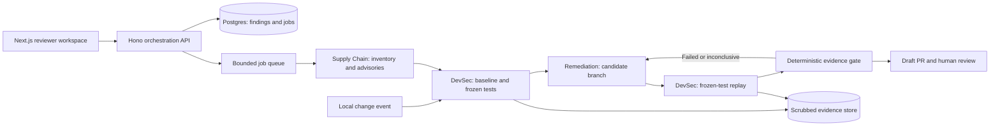

# ProofPatch — phased product requirements

**Version:** 1.1 · **Research date:** 24 October 2026 · **Team:** 4 members  
**Stage:** Checkpoint 1 · **Working name:** ProofPatch (name availability not checked)  
**Planning assumption:** 48-hour MVP build window; duration remains unconfirmed.

**Implementation update (25 October 2026, Asia/Calcutta):** The service now uses a shared ten-node LangGraph workflow with persisted checkpoints and actual LangChain ChatGroq roles. A separate worker watches registered GitHub repositories every 300 seconds by default, inventories exact Python requirements/npm package-lock/Composer lock dependencies, corroborates package/version findings with OSV, and records forum leads separately as unconfirmed. Newly observed leads receive bounded read-only Groq triage; their text cannot authorize a repair. Multiple advisories for the same package/version/target share one repair run.

The current automatic package-repair profile supports the owned fictional Sakura Python repository: Requests 2.31.0 → a published same-major release rechecked with OSV (2.34.2 at this update), preserving application source, then frozen hosted checks and a separate senior-review context before draft publication. Arbitrary accessible repositories can be registered for supported inventory monitoring; they remain monitor-only until a maintainer-approved verification policy exists. The retained Japanese PHP advisory workflow performs its three reviewed runtime/configuration changes. One dashboard shows repository controls, watch/source health, findings, a plain-language six-step journey, the technical graph, progress, actual test evidence and human PR handoff.

See [the executed handoff](IMPLEMENTATION-HANDOFF.md), [judge runbook](LIVE-DEMO.md), [coverage/onboarding](REPOSITORY-ONBOARDING.md) and [server deployment configuration](SEPARATE-SERVER-DEPLOYMENT.md). No remote server deployment, GitHub App installation flow, tenant isolation, X connector, universal code migration, exploit-completeness guarantee or automatic merge is claimed. Graph history persists; automatic replay after worker loss is not implemented. The initial TypeScript persona, local-development pentest entry point, broader phases and market assertions below are historical research hypotheses rather than current coverage. Billing and production SaaS controls remain planned.

## 1. Product decision

Build a narrow, evidence-first security remediation workflow for small TypeScript SaaS teams. Three agents help developers identify relevant risk, reproduce a failure, and propose a fix. A deterministic gate and developer review decide whether the change can advance.

**One sentence:** ProofPatch turns a security finding into a proposed patch with replayable before/after evidence and a human-reviewed pull request.

**Confirmed agent model:** Supply Chain discovers upstream risk; Remediation proposes supported updates and code repairs; Development Security monitors local changes, establishes baseline checks and verifies candidates. Local-code findings can enter directly through Development Security. The controller routes jobs; the deterministic gate enforces evidence and unresolved follow-up. See [the current architecture contract](THREE-AGENT-ARCHITECTURE.md).

The number of agents is an implementation choice, not the value proposition or a defensible moat. The proposed wedge is reusable tenant-boundary regression packs, portable evidence, and low-friction customer-owned execution. These advantages remain hypotheses until compared with alternatives.

## 2. Problem understanding — 35% of judging

### Primary persona and job

Initial customer hypothesis: a B2B SaaS team with 5–30 developers, TypeScript/Node services, tenant-scoped customer data, frequent releases, and no dedicated application security engineer. The CTO or engineering lead buys. A developer uses the tool. Agencies managing several SaaS repositories are a secondary segment to investigate, not the initial target.

**Job:** “When a scanner or review finds a security issue, help me determine whether it matters in my app, fix it without breaking legitimate behavior, and give my reviewer evidence they can check.”

### Current workflow and failure points

| Step | Developer work | Hypothesized friction | Observable validation evidence |
|---|---|---|---|
| Receive | Dependency alert, code finding, customer report | Many signals, inconsistent context | Actual backlog and recent alert history |
| Triage | Establish affected version, reachable path, exposure | Severity alone does not explain business impact | Time spent classifying last five alerts |
| Reproduce | Set up users, tenants, fixtures | Authentication and realistic test setup take time | Screen-shared reproduction of a recent issue |
| Repair | Update a package or change custom logic | Compatibility concerns and code ownership | Patch iterations and abandoned fixes |
| Verify | Rerun security check and normal workflows | Closing an alert does not prove normal behavior survived | Reviewer questions and failed CI runs |
| Review | Explain risk, diff, tests and residual limitations | Evidence scattered across tools | Time until review and requests for additional proof |

This workflow is an informed hypothesis. No interviews, paid users, integrations, or time-saving results have been obtained for this project.

### Evidence and its limits

Verizon reports that vulnerability exploitation initiated 31% of breaches in its 2026 DBIR, based on 2025 incident data. This supports the importance of remediation, but does not measure our target customers or prove demand for this product. [S1]

Existing investment in automated remediation validates a category, not this particular business. GitHub, Snyk, and Aikido already address important parts of the workflow. [S2–S5]

### Problem statement for the submission

“Small SaaS teams can receive security findings faster than they can confidently resolve them. Moving from an alert to a reviewed fix still requires application context, realistic reproduction, compatible changes, and regression evidence. We are testing whether a narrowly scoped, evidence-first remediation workflow reduces that work for teams without dedicated AppSec staff.”

### What we must learn

1. Is triage, reproduction, fixing, or review the largest active-time cost?
2. Do teams trust a generated regression test, and what independent evidence is required?
3. Do tenant-boundary issues occur frequently enough to justify the proposed initial focus?
4. Is deployment of a customer-owned runner acceptable for this buyer?
5. What would make a team pay instead of using Dependabot plus its current coding assistant?

## 3. Idea and differentiation — 30%

### Three roles and a separate gate

| Role | Inputs | Responsibilities | Output | Permissions |
|---|---|---|---|---|
| Supply Chain Agent | Lockfile/SBOM, runtime inventory, scanner results, approved feeds | Match affected versions, distinguish vulnerabilities from package compromise, deduplicate and track source revisions | Risk brief with source, affected range, confidence and scope | Read inventory and approved advisory feeds; cannot patch |
| Remediation Agent | Risk brief or local-code finding, frozen checks, repository snapshot | Propose a scoped code repair or supported compatible dependency/runtime update; explain rollback | Candidate diff and update plan | Write to a disposable branch; cannot modify frozen tests or merge |
| Development Security Agent | Local change or upstream finding, explicit authorization, isolated fixture | Monitor changes, establish baseline, freeze checks, run scoped security tests and legitimate-use controls, verify candidate | Local finding, versioned check pack and verification evidence | Run bounded tests in an isolated owned environment; cannot edit candidate code |
| Deterministic policy gate | Baseline, candidate replay, regression suite, commit/test identities | Enforce required evidence, budgets, provenance and scope | Eligible, blocked or inconclusive decision | No LLM override |
| Human reviewer | Diff, evidence bundle and limitations | Accept, request changes, or reject | Merge decision | Repository's normal branch protections |

Development Security freezes checks before candidate writes and reruns them after Remediation completes. Separate roles improve accountability but do not guarantee independent reasoning, especially if they share a model. Frozen tests, withheld benign controls, immutable artifacts, and an explicit gate are the stronger controls. A deterministic controller enforces dispatch, scopes and budgets; it is not a fourth agent. All agents contribute to a shared evidence store. Incident or environment follow-up prevents promotion even when automated checks pass.

### Competitive reality

| Alternative | Capability verified in official sources | Implication for our pitch |
|---|---|---|
| Dependabot | Opens security-update PRs for vulnerable dependencies. [S2] | Dependency update automation is baseline functionality. |
| GitHub Agentic Autofix | Generally available 15 October 2026; generates fixes, reruns CodeQL, opens draft PRs for review. [S3] | “AI fixes and verifies code” is not a novelty claim. |
| Snyk Agent Fix | Agentic remediation for Snyk Code vulnerabilities. [S4] | Do not claim AI-assisted code repair is missing from incumbents. |
| Aikido Infinite | Continuous testing, exploit validation, AutoFix, and retesting. [S5] | Even a discover/fix/retest loop overlaps directly with existing products. |
| ProofPatch | Proposed small-team onboarding, portable tenant-boundary test packs, bounded customer-owned runs | These are proposed positioning choices, not proven exclusive features. |

Do not use a competitor table full of unsupported “No” marks. This research is a capability comparison, not an independent accuracy or pricing benchmark. Feature availability may vary by plan.

### Why this scope can still work as a hackathon project

One explainable failure and an auditable review journey are easier to demonstrate convincingly than “pentest everything.” Tenant isolation makes business impact legible: a user from one customer must never read another customer's invoice. The judge can understand the before/after behavior and the legitimate request that must remain valid.

Other directions considered: a secrets-remediation agent, cloud-configuration agent, or compliance-report agent. All are plausible later modules. For this round, adding them weakens scope and evidence. Complete the repair-and-review loop first.

## 4. Product scope and requirements

### P0 requirements

| ID | Requirement | Acceptance criterion |
|---|---|---|
| F01 | Findings queue | Show source, repo, severity, status, confidence, and evidence freshness; distinguish synthetic data. |
| F02 | Scope authorization | Real runs require repository/environment ownership, approved target, test types and run budget. Reject missing or expired scope. |
| F03 | Advisory intelligence | Resolve installed versions from lockfiles against machine-readable advisories; store source URL, retrieval time, advisory revision and affected/fixed ranges. |
| F04 | Prioritization | Show observed exposure and test evidence separately from CVSS. Unknown reachability remains unknown. |
| F05 | Reproduction | Test must demonstrate the violated security expectation on the baseline; clean controls must pass. Inconclusive results cannot become “verified.” |
| F06 | Patch proposal | Produce a scoped diff in a disposable branch; do not change test expectations to make the patch pass. |
| F07 | Replay | Run the identical frozen security check on candidate code, plus benign regression controls. |
| F08 | Eligibility gate | Require evidence-class-appropriate affected baseline, candidate pass, benign regression pass, matching test identity, matching commit, non-expired evidence and no unresolved incident/configuration follow-up. Any failure or uncertainty blocks promotion. An advisory match does not imply exploit reproduction. |
| F09 | Review packet | Include diff, rationale, exact commands, versions, test identities, outcomes, timestamps, logs, limitations and rollback instructions. |
| F10 | Draft PR | After authorization, prepare a draft PR with checks and evidence links; no automatic production merge. |
| F11 | Stop and budget | Enforce wall-time, tool-call, token, network and spend budgets; stopping a run revokes runner credentials and leaves an auditable state. |
| F12 | Replay and export | Export a versioned JSON/Markdown evidence bundle. A reviewer can replay it against the recorded commit. |
| F13 | Local development triggers | DevSec receives scoped Git/file events, debounces changes, invalidates stale evidence, and reruns approved checks. No implicit production targets or perpetual unbounded scans. |
| F14 | Agent orchestration | Typed jobs route among exactly three agents with separate permissions and shared artifacts. DevSec records baseline before Remediation writes; candidate returns to DevSec; failed controls permit only bounded repair retries. |
| F15 | Supply-chain response classes | Distinguish vulnerable component/runtime from compromised package. Record provenance and source freshness; retain incident or environment follow-up rather than treating every update as closure. |

### Dependency upgrade policy

“Latest version” is not a sufficient policy. Prefer a maintained release that fixes the advisory and is compatible with the project's supported line. Recompute transitive resolution and lockfile, check engine requirements, scan the resulting graph, run contract/build tests, and record why the target was chosen. Major upgrades require an explicit migration review. If no supported fix exists, show mitigation/escalation and a residual-risk decision instead of inventing a safe version.

A changed or retracted advisory invalidates stale decisions and triggers re-evaluation. Automated monitoring is planned for the product; this deliverable does not start recurring scans or automations.

### Test types

- Initial supported security regression: two synthetic tenants and authenticated fixture users; verify object access ownership.
- Dependency verification: advisory-range match and removed vulnerable resolution, with actual application smoke tests. This is not proof of exploitability.
- Header configuration: explicit response assertion. Label it configuration evidence.
- ZAP baseline may supplement passive checks. Its documented baseline mode does not perform active attacks and must not be represented as a complete pentest. [S7]

### Non-goals for the first MVP

Arbitrary internet targets, production exploitation, full pentest certification, guaranteed detection, automatic merging/deployment, all languages, zero-day discovery, exploit marketplaces, compliance certification, or claims that any passing test establishes complete security.

## 5. Checkpoint 1 prototype — development is 10%

**Implemented:** Next.js frontend; actual React Flow orchestration canvas; selectable agent input/output/permission details; simulated dependency, local-change, PHP-runtime and Composer-compromise runs; stop/reset; handoff trace and JSON export; three seeded findings; filtering and local persistence; evidence/diff/review tabs; failed-validation gate; local draft preview; responsive roadmap/business view.

**Simulated:** agents, scanning, advisory retrieval, reproduction outputs, patches, cryptographic identities, and PR preparation. No real repository is inspected or changed; no GitHub PR is created. The demo dependency is fictional and has no CVE claim.

The local verification eligibility function is real application logic and is tested. Its input evidence is synthetic. This distinction should be stated in the pitch.

### Demonstration script

1. Open Overview and explain who the product is for.
2. In Agents, select Local code-change fixture and simulate the handoff: controller → DevSec baseline → Remediation → DevSec replay → gate. In Overview, Run demo retains the detailed invoice fixture walkthrough.
3. Inspect Patch diff and Evidence. Before: unauthorized request gets 200. After: 404. Owner's legitimate request must remain successful.
4. Choose “Regression fails.” Rerun verification. The draft gate blocks even though the security replay passes.
5. Choose “All checks pass,” verify, and prepare the local draft. Export the evidence JSON.
6. Show Roadmap and acknowledge what is planned.

Keep the primary pitch demo to 30 seconds. The 90-second walkthrough is for follow-up questions or a longer slot.

## 6. Phased roadmap and exit gates

| Phase | Time assumption | Deliverables | Exit gate | Explicitly deferred |
|---|---|---|---|---|
| 0: Checkpoint 1 | Now | Research memo, PRD, clickable prototype, deck, judge Q&A | Judge can state user, pain, workflow, alternatives and business hypothesis; every simulated result labeled | Live scanning and agent claims |
| 1: Thin working loop | 0–24 h of MVP | Owned fixture repo, one real scanner adapter, baseline security regression, proposed patch, replay evidence | At least one actual failure-before/pass-after loop and one blocked bad patch with commands/logs | Generalized autonomous pentesting |
| 2: Demo-ready MVP | 24–48 h | Job state handling, isolated fixture runner, evidence export, draft-PR integration if credentials available, polished demo | Repeatable clean setup; bounded runs; no false successful promotion; recorded demo fallback | Production deployment and broad language support |
| 3: Design-partner pilot | 2–4 weeks | GitHub App, scoped customer-run runner, artifact retention, budgets, real workflow observation | 3 scoped pilots, evidence that reviewers use outputs, 2 paid commitments target | Scale-first infrastructure |
| 4: Beta | After pilot gates | Tenant isolation, audit logs, incident handling, expanded packs and integrations | Security review of the tool itself; benchmark precision and replay reliability; unit economics acceptable | Unbounded scans or security guarantees |

Milestones are estimates, not promised delivery dates. If time is limited, retain one genuine regression loop and remove breadth.

### Four-member allocation

| Member | Ownership | 0–12 h | 12–24 h | 24–36 h | 36–48 h |
|---|---|---|---|---|---|
| A | Frontend and demo | Integrate prototype and domain types | Real job states and evidence display | Failure/retry/reset paths | Responsive QA and demo recording |
| B | Supply Chain Agent | OSV/scan import, lockfile scope | Normalization and evidence links | Deduplication and freshness | Validate known clean/vulnerable fixtures |
| C | Remediation Agent | Candidate branch and tenant repair | Update/patch and rollback | Compatibility and bounded retries | Candidate reproducibility |
| D | DevSec and controller | Auth/tenant fixture and frozen tests | Isolated baseline/patch replay | Job budgets, cancellation, evidence handoff | Fail-closed integration checks |

Integrate by hour 12 and again at 24; avoid four separate demos. Members B/C/D share a single evidence contract. All four share interviews, cost research and pitch preparation. At hour 36 freeze scope. Each person can explain the problem and limits, not only their feature.

## 7. Proposed architecture



Use existing scanners rather than build a vulnerability database. OSV-Scanner connects a dependency inventory to known vulnerabilities. [S6] Add code scan adapters only as needed. The LLM may summarize context and propose a repair; tools establish test outcomes. Fixed workflow orchestration is enough initially; avoid a complex multi-agent framework before the single loop works.

Suggested future repository layout follows the user's saved project conventions:

```text
apps/web/src/{app,components,lib,hooks,services,types,styles}
apps/api/src/{routes,handlers,services,middleware,validators,config,db}
packages/contracts/       # shared API and evidence schemas
packages/runner/          # isolated execution supervisor
fixtures/tenant-invoices/ # owned, intentionally vulnerable test fixture
docs/                    # PRD, research, runbook, pitch
```

Only `apps/web` is implemented at Checkpoint 1. There is no fake backend scaffolding presented as functional infrastructure.

### Core records and API contract

Repository(id, installationId, owner, defaultBranch); Scope(id, repoId, environment, allowlist, budget, expiresAt); Finding(id, source, advisoryId?, package?, affectedRange?, path?, severity, confidence, observedExposure, status); Run(id, findingId, baseCommit, candidateCommit, testHash, toolVersions, scopeId, startedAt, finishedAt, costs, outcome); Artifact(id, runId, contentHash, redactedUri, retentionUntil); Patch(id, runId, diffHash, branch, draftPrUrl?); AuditEvent(actor, action, entity, timestamp).

Planned endpoints: `POST /runs` validates authorization and budget; `GET /runs/:id` returns job progress; `POST /runs/:id/cancel` stops work; `GET /findings` lists scoped results; `GET /runs/:id/evidence` exports redacted records; `POST /patches/:id/draft-pr` requires fresh eligible evidence and an authorized human action. Idempotency keys prevent duplicate runs and PRs. Webhooks are signature-verified and deduplicated.

### State model

Detected → Triaged → Reproducing → Reproduced → Patching → Verifying → Review ready → Draft opened → Human merged. Alternate terminal/holding states: Out of scope, Not reproduced, Inconclusive, Blocked, Cancelled, Failed, Accepted risk. Do not turn a timeout into a pass or mark a finding resolved just because a PR exists. Revalidate after changes to code, tests, dependencies, or scope.

### Security of the security tool

Repository content, issue text, advisories and logs are untrusted data, not agent instructions. Use ephemeral runners with no production secrets, deny egress except explicit allowlists, restrict filesystem access, use short-lived scoped tokens, and redact artifacts before model access. The Remediation Agent cannot edit the verification harness. Establish authenticated tenant context in the server rather than trusting request-supplied tenant IDs. Audit administrative actions and enforce tenant ownership on every API read/write. These are product requirements, not controls already implemented by the prototype.

## 8. Business understanding — 25%

### Value and initial offer

Sell reduced developer effort and more reviewable evidence. Avoid breach-prevention guarantees. First offer: a scoped pilot for a small SaaS team using its existing workflow as the baseline.

**Pricing hypothesis:** ₹4,999/workspace/month for up to 3 repositories and 30 bounded validation runs. Hypothetical additional run price: ₹149. A run is capped by agreed wall-time and model/tool budgets; retries consume the allowance. Offer a narrowly capped evaluation. Pricing, scope, currency choice, and willingness to pay need interviews.

### Illustrative unit economics, not measured financial results

| Scenario | Compute/model cost | Infrastructure allocation | Monthly variable cost | Contribution before other costs |
|---|---:|---:|---:|---:|
| Base assumption | 30 × ₹25 = ₹750 | ₹500 | ₹1,250 | ₹3,749 / 75.0% |
| Expensive runs | 30 × ₹100 = ₹3,000 | ₹500 | ₹3,500 | ₹1,499 / 30.0% |

Excludes support, salaries, taxes, payment fees, customer acquisition and fixed costs. Model tokens, runtime, retries and artifact retention must be measured. At the base assumption, contribution break-even run cost is about ₹149.97 if all other costs stay unchanged; this is not a recommended spending limit. A lower operating cap is needed to fund the excluded costs. An overage of ₹149 is viable only under a bounded cost distribution and therefore remains provisional.

Illustrative customer ROI: if a team saves four active developer hours/month at an assumed loaded cost of ₹1,500/hour, value is ₹6,000/month. Both assumptions require customer evidence; do not quote this as an achieved saving.

### Market sizing discipline

Do not invent a global TAM. Use a reachable-account exercise: build a named list of qualified SaaS teams from incubators and developer communities, confirm eligibility, then test outreach and conversion. The scenario **100 paying workspaces × ₹4,999 × 12 = ₹59,98,800 annual revenue (₹59.988 lakh)** is arithmetic, not an estimated addressable market, pipeline, or forecast.

### Distribution and validation

Start with founder/developer communities and incubators; these are proposed channels, not existing partnerships. Publish a reproducible demo and benchmark. Recruit five potential design partners, prioritize three scoped pilots, then test willingness to pay. A customer-owned runner may help code-confidentiality concerns, but could increase onboarding and support costs.

First two weeks: conduct 10 qualified interviews, observe 5 real remediation workflows, run 3 scoped pilots, and seek 2 paid commitments. If teams value a CLI evidence export but reject a dashboard, pivot packaging. If no meaningful advantage appears over current tooling, narrow to a test-pack integration or stop the broader platform idea.

## 9. Measurement and evaluation

North-star candidate: **median active developer minutes from accepted finding to review-ready fix**, compared on matched tasks against each team's existing workflow. Separate active effort from elapsed CI/queue time. Record issue complexity and order effects.

Pilot target: at least 30% lower median active effort across paired tasks, without increased invalid fixes. This is a target, not a result. Supplement with reviewer confidence and actual evidence use.

| Metric | Definition | Initial evaluation gate |
|---|---|---|
| Reproduction precision | Confirmed true issues / issues labeled reproduced | Manually adjudicate every pilot result; report numerator and denominator |
| False promotion | Inadequate fixes labeled review-ready | Zero on the small controlled benchmark; does not establish a population rate |
| Replay reliability | Same outcome on same commit/test/environment | Repeat each benchmark run three times; investigate any drift |
| Regression retention | Legitimate control requests still pass | Mandatory on every candidate |
| Evidence completeness | Required fields present and identities match | 100% for eligible runs |
| Cost per accepted fix | All run/retry cost / accepted fixes | Measure distribution and worst case; enforce caps |
| Adoption | Pilot teams returning to use tool on a second task | Observe, do not substitute signups for use |

Working MVP benchmark: 12 owned cases, including 4 genuine seeded vulnerabilities, 4 clean cases and 4 near-misses/bad-patch variants. Include a correct tenant fix, an overbroad denial breaking legitimate access, a changed-test attempt, a stale commit, a timeout, and an unsupported advisory fix. The correct output for uncertainty is inconclusive/blocked.

## 10. Risks, decisions and release criteria

| Risk | Impact | Mitigation / test |
|---|---|---|
| Crowded market | Generic pitch offers little reason to switch | Test narrow onboarding and evidence utility against existing tools |
| Self-validating agents | A wrong patch looks successful | Frozen tests, separate permissions, hidden controls, human review |
| Compatibility break | Upgrade fixes one issue and breaks the app | Maintained compatible versions, lockfile and contract tests |
| Missed vulnerabilities | False confidence | Explicit coverage, uncertainty and residual limitations |
| Prompt injection / malicious repository | Tool misuse or data leakage | Untrusted-input boundaries, sandboxing, scoped tools and egress |
| Cost runaway | Unviable pricing | Per-run limits, retries bounded, cancellation and metering |
| Test environment mismatch | Staging result fails to reflect deployment | Record environment digest; state environment-specific limitations |
| Customer onboarding friction | Pilot fails before value appears | Concierge setup, measure setup time, customer-controlled credentials |

Release criteria for real MVP: every execution scoped; malicious fixture cannot escape the runner; failed/inconclusive verification never promotes a draft; clean control tests pass; exported evidence matches the actual commit; secrets scrubbed; a fresh teammate reproduces the demo from the runbook. Broader security review is required before production use.

## 11. Source register

All sources below were consulted on **24 October 2026**. Product documentation describes vendor capabilities; it is not independent performance evidence.

- **S1:** [Verizon 2026 DBIR announcement](https://www.verizon.com/about/news/breach-industry-wide-dbir-finds) — problem context.
- **S2:** [GitHub Dependabot security updates](https://docs.github.com/en/code-security/concepts/supply-chain-security/dependabot-security-updates) — dependency update PRs.
- **S3:** [GitHub Agentic Autofix GA, 15 Oct 2026](https://github.blog/changelog/2026-10-15-agentic-autofix-for-code-scanning-alerts-general-availability/) — competitor workflow.
- **S4:** [Snyk Agent Fix documentation](https://docs.snyk.io/scan-fix-and-prevent/scan-with-snyk/snyk-code/manage-code-vulnerabilities/fix-code-vulnerabilities-automatically) — competitor remediation.
- **S5:** [Aikido Infinite](https://www.aikido.dev/blog/introducing-aikido-infinite) — continuous testing and remediation loop.
- **S6:** [OSV-Scanner official documentation](https://google.github.io/osv-scanner/) — dependency intelligence option.
- **S7:** [ZAP baseline scan documentation](https://www.zaproxy.org/docs/docker/baseline-scan/) — passive baseline limitations.
- **S8:** [PHP 2026 notices](https://www.php.net/archive/2026.php) — October 21 runtime advisory and October 23 configuration follow-up; not a malicious Composer release.
- **S9:** [intercom/intercom-php maintainer advisory](https://github.com/intercom/intercom-php/security/advisories/GHSA-gr3r-crp5-qrrm) — distinct Composer compromise and incident-response context.
