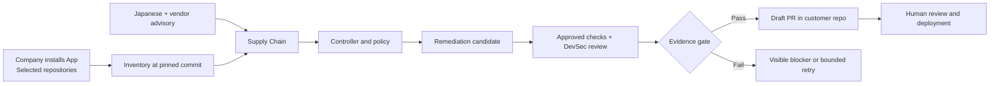

# How a company would use ProofPatch

The proposed SaaS connects to a company's GitHub organization through a GitHub App. A developer selects repositories once, approves a verification policy, and reviews the resulting draft pull requests in GitHub. The ProofPatch dashboard becomes the shared place to follow advisory impact, agent execution, checks and unresolved owner tasks.

**Current implementation:** the local hackathon service is connected to the team's owned `Harsh5840/arigato-php-demo` repository. It performs real Japanese advisory intake, actual Groq calls, hosted PHP verification and draft PR creation. GitHub App installation, arbitrary customer repositories, continuous monitoring, tenant authentication and billing are proposed work. A repository URL field alone would not provide those capabilities.

## Proposed customer journey

1. **Connect GitHub.** An authorized administrator installs the ProofPatch GitHub App on the company's organization and chooses **Only select repositories**. GitHub shows the requested permissions and applies the organization's installation policy. Installation grants repository access; signing in to the dashboard is a separate identity concern. [GitHub installation guide](https://docs.github.com/en/apps/using-github-apps/installing-a-github-app-from-a-third-party)
2. **Select scope and checks.** ProofPatch imports approved runtime declarations and lockfiles, records the base commit, and asks the maintainer to approve allowed edit paths, test commands, runner, branch policy and evidence retention. Initial supported policy packs should remain explicit, such as the bounded PHP case, rather than promising repairs for every framework.
3. **Watch advisories and changes.** Scheduled source ingestion matches verified advisories against inventory. Signed repository events refresh the inventory after relevant pushes. Display last successful sync, source provenance and unsupported components. Until scheduling exists, label a scan **Run now**, not continuous protection.
4. **Propose and verify.** The read-only Supply Chain role explains impact; Remediation proposes a scoped candidate; deterministic checks and the DevSec review evaluate the exact candidate commit. The controller owns budgets, permission boundaries and publication eligibility.
5. **Review in GitHub.** A draft PR contains the diff, Japanese/English rationale, real check links, rollback notes and remaining owner tasks. Branch rules and human review remain in force. A passing draft is not deployment or finding closure.
6. **Manage access.** The customer can remove repositories or uninstall the App. ProofPatch must stop new work, invalidate access and apply a disclosed retention/deletion policy. These lifecycle controls need implementation before onboarding private customer code.

GitHub installation tokens can be narrowed to the repositories and permissions granted to that installation, and expire after one hour. The service should mint them on demand and keep them server-side. [Installation token documentation](https://docs.github.com/en/apps/creating-github-apps/authenticating-with-a-github-app/generating-an-installation-access-token-for-a-github-app)

## Proposed permissions and trust boundary

| Permission | Purpose | Product rule |
|---|---|---|
| Metadata: read | Identify installed repositories | Resolve access from the installation and repository IDs, not a browser-supplied owner name. |
| Contents: read/write | Read the pinned baseline and create candidate branches/commits | Permit writes only through the controller's scoped candidate path. GitHub's permission is broader than that application-level rule. |
| Pull requests: read/write | Reconcile existing drafts and create an evidence packet | No automatic merge. Check returned PR head against the verified candidate. |
| Actions: read/write | Dispatch the maintainer-approved verification workflow and read execution state/artifacts | Request write only when ProofPatch actually dispatches customer workflows. Read-only observation can use a narrower permission. |
| Workflows | Access/edit Actions workflow files when that operation requires it | Do not include this in routine repair. Let a maintainer review and install the verification workflow separately; the fixer cannot edit it. |

The precise permissions depend on each API operation and the selected verification architecture. GitHub recommends the minimum necessary permissions and documents endpoint requirements. Contents access and the separate Workflows permission are not interchangeable. [GitHub App permissions](https://docs.github.com/en/apps/creating-github-apps/registering-a-github-app/choosing-permissions-for-a-github-app)

Dispatching an existing `workflow_dispatch` workflow requires Actions write; it is different from editing its YAML. The workflow must already declare that trigger. Keep the trusted workflow on the approved default branch, pass commit identities as validated data, and reject changes to the frozen verifier. [Workflow dispatch API](https://docs.github.com/en/rest/actions/workflows#create-a-workflow-dispatch-event)

Verify webhook HMAC-SHA256 against the raw request body before processing it, using constant-time comparison. Deduplicate delivery IDs, check installation/repository membership again when claiming a job, and handle removed access. The signature proves delivery integrity; it does not make repository content or candidate code trusted. [Webhook validation](https://docs.github.com/en/webhooks/using-webhooks/validating-webhook-deliveries)

Private-repository isolation is a ProofPatch responsibility; installing a GitHub App does not implement tenancy. Every run, event, artifact and repository record must bind to a tenant and installation. Enforce authorization at API and worker boundaries, isolate runner workspaces, keep credentials out of candidate execution, and disclose which code leaves the runner for the model provider. Encryption, retention, deletion and provider data terms must be settled before claiming production readiness. These are design requirements, not implemented assurances.

## One dashboard for developers

The default screen should show one connected demo repository, one prominent **Run advisory check** action, a source-to-PR orchestration graph, live progress, the selected candidate's real checks, and a draft PR handoff. Selecting a graph stage should reveal its actual input/output or evidence in place. Keep source URLs, commit identities and logs available as drill-down details. Remove synthetic posture scores, marketing copy, historical roadmap cards and invented repository counts from the operational screen.

Useful analytics can be calculated from persisted runs without inventing organizational risk:

| Component | Calculation and caveat |
|---|---|
| Run outcomes | Counts of stored completed, failed, blocked and cancelled runs. A failed experiment remains visible. |
| Time to draft | Actual elapsed time for completed runs with a recorded PR; show the sample size. An active run shows elapsed time separately. |
| Checks | Passed/failed/pending/not-run for the selected candidate, with a link to CI. Never count missing evidence as passed. |
| Role usage | Actual input/output/total tokens reported by Groq. Cost needs configured pricing; tokens alone are not a dollar estimate. |
| Drafts awaiting review | Unique recorded draft PR URLs. Several runs that reuse one PR count as one draft. |
| Run history | Real timestamps and outcome bars. With one run, show one run; do not manufacture a trend. |

The dashboard's connection panel should say **Demo repository connected** and identify the owned target. A small **Company setup** drawer can explain the proposed GitHub App journey with a clear **Planned** label. Do not show a working install button without an actual App registration and authenticated onboarding backend.

## A credible judging demo

Start one live run before the presentation and retain the previous completed run as an explicitly dated fallback. GitHub queue time and Groq latency vary; a 90-second pitch cannot guarantee a new runner finishes within that slot.

| Time | Show and say |
|---|---|
| 0–15 seconds | Point to the connected SakuraShop repo and the Japanese/vendor source. “This is an owned PHP demo repository. A company would install our GitHub App on selected repositories.” |
| 15–40 seconds | Start a run, or open the already-running live job. Follow Supply Chain → Remediation → DevSec on the same dashboard. Show actual model IDs and a source/commit drill-down. |
| 40–65 seconds | Open actual verification progress or the clearly dated completed run. Show runtime/config checks and the Japanese storefront's UTF-8, JPY and authorization tests. |
| 65–90 seconds | Follow the real draft PR link. Show the three-file diff, exact candidate SHA, CI evidence and remaining owner tasks. “The service prepares evidence for a human reviewer; it does not merge or deploy.” |

Keep a second browser tab on the real GitHub Actions run and another on the resulting draft. If a provider or runner fails, show the failure state and explain the gate rather than substituting a simulated success. The full operator setup and actual execution limits remain in [LIVE-DEMO.md](LIVE-DEMO.md).

Research checked against the five linked official GitHub documentation pages on 25 October 2026 (Asia/Calcutta). The customer journey and dashboard recommendations are proposed ProofPatch design.
