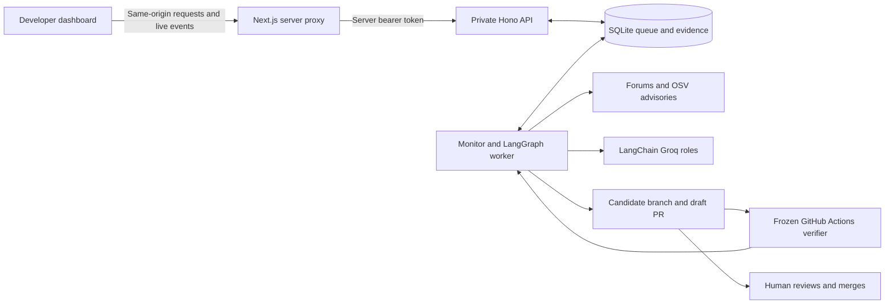

# Run ProofPatch as a separate monitoring service

The application now supports an API, a worker and a dashboard running as separate processes or containers. The worker watches the repositories added in the dashboard, persists its queue and LangGraph checkpoints, calls Groq, and sends scoped candidate changes to GitHub. GitHub Actions runs the approved verifier. A verified draft PR is the final automated output; a person reviews and merges it on GitHub.



## Docker Compose on one server

Create an untracked `.env` at the repository root. Populate these values locally; never paste them into a submission or commit them:

```dotenv
GROQ_API_KEY=YOUR_SERVER_GROQ_KEY
GITHUB_TOKEN=YOUR_REPOSITORY_SCOPED_GITHUB_TOKEN
API_TOKEN=YOUR_RANDOM_SERVER_TOKEN_WITH_AT_LEAST_32_URL_SAFE_CHARACTERS
WEB_ORIGIN=http://127.0.0.1:3000
```

Generate the API token with `node -e "process.stdout.write(require('node:crypto').randomBytes(32).toString('hex'))"` and store the result privately. The GitHub token needs the repository permissions required by the selected verification profile: metadata and contents access, Actions dispatch/read access, and pull request write access. Container execution uses the supplied GitHub token; it does not use a host Git Credential Manager session.

From the repository root:

```sh
docker compose config --quiet
docker compose up --build -d
docker compose logs -f api worker
```

The dashboard is available at `http://127.0.0.1:3000`. The API has no published host port. The web server calls `http://api:8787` over the Compose network, adds the server token and streams API events back to the browser. Groq and GitHub credentials are supplied only to the API/worker services. The browser never receives the server token.

The `state` volume stores the SQLite queue, monitoring state and LangGraph checkpoints. The `evidence` volume retains run outputs. Keep one worker replica and keep both roles on the same host while using SQLite; do not share its WAL files over a network filesystem. Back up the volumes consistently before upgrades. Worker loss fails closed and preserves evidence for inspection; automatic resumption of external writes is not implemented.

Both images use the exact Node 22.23.4 Bookworm slim tag and registry index digest verified on 25 October 2026. Dependency installation uses the committed lockfiles. The API image currently retains `tsx` and its development dependency tree because the existing entrypoints execute TypeScript. This is a hackathon deployment baseline, not an attestation that either image has been vulnerability scanned.

## Put the web and API on different machines

API process settings:

```dotenv
API_HOST=0.0.0.0
API_PORT=8787
API_TOKEN=THE_SAME_PRIVATE_RANDOM_TOKEN
API_TRUSTED_HOSTS=api.internal.example,127.0.0.1,localhost
WEB_ORIGIN=https://security.internal.example
```

Next.js server settings:

```dotenv
PROOFPATCH_API_ORIGIN=https://api.internal.example
API_TOKEN=THE_SAME_PRIVATE_RANDOM_TOKEN
PROOFPATCH_WEB_ORIGIN=https://security.internal.example
```

`PROOFPATCH_API_ORIGIN` is one server-controlled HTTP(S) origin without a path, query, credentials or fragment. The proxy only forwards supported `/api/…` paths and bounded JSON bodies; request parameters cannot select a different destination. It ignores browser Authorization/Cookie headers and supplies its own API bearer token. Do not prefix any of these variables with `NEXT_PUBLIC_`.

The API refuses to bind outside loopback without a 32–256-character URL-safe token. It checks bearer tokens with constant-time digest comparison, rejects untrusted Host headers, and keeps exact dashboard-origin and JSON mutation checks. Set the external hostname used by your reverse proxy in `API_TRUSTED_HOSTS`; do not use a wildcard. Use TLS and a private network for communication across machines.

For local development, `API_HOST` defaults to `127.0.0.1` and no API token is required. The root `npm run dev` launcher reads root `.env` and supplies the matching server-only proxy variables to Next.js. If starting Next.js separately, provide those variables in `apps/web/.env.local` or its shell; Next.js itself does not read the monorepo root environment file.

## Judge demonstration and product boundary

Keep this operator dashboard private. The current project has a server token between its web server and API; it does not yet implement end-user login, per-company tenancy or a GitHub App installation flow. For a demonstration from a server, use a VPN or an authenticated access proxy, or forward the private web port through SSH. A public SaaS launch requires those product access controls.

Add a repository in the dashboard and inspect its inventory and findings. Generic monitoring covers supported exact PyPI, npm and Packagist dependency manifests. Automatic patching requires a maintainer-approved verification profile; the shipped PHP and Python fixtures demonstrate those policies. Other repositories can be monitored without granting arbitrary model-generated commands permission to run.

Validation performed here: API/proxy unit tests, TypeScript checks, and `docker compose config --quiet` with dummy credential values. Docker Desktop's Linux engine was unavailable, so image builds, container startup, volume permissions and an actual remote deployment remain unverified. Validate those commands on the target server before presenting a hosted URL.

Sources: [Next.js self-hosting](https://nextjs.org/docs/app/guides/self-hosting), [Next.js standalone output](https://nextjs.org/docs/app/api-reference/config/next-config-js/output), [Node.js release index](https://nodejs.org/dist/index.json).

The root `npm run dev` launcher now loads root `.env` and passes server-only API proxy configuration to Next.js while withholding Groq/GitHub provider secrets from the web process. When launching Next.js separately, supply its API variables through the shell or `apps/web/.env.local`.
