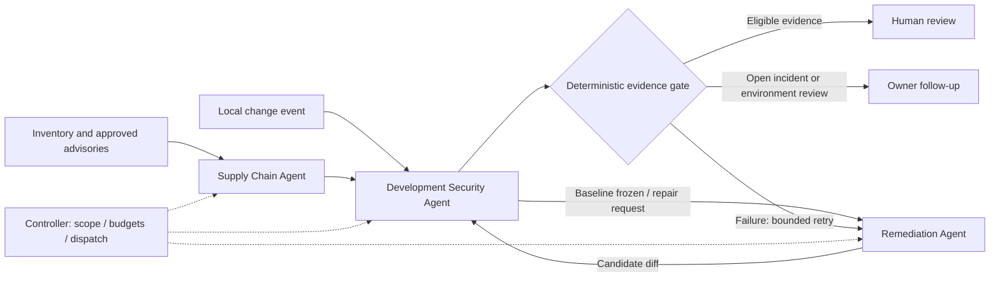

# ProofPatch: three-agent security orchestration

Updated 24 October 2026. This is the product architecture and the contract represented by the frontend. Agent services, watchers and test runners are planned; the current implementation simulates their outputs.

## The three agents

| Agent | Owns | Produces | Boundary |
|---|---|---|---|
| Supply Chain Agent | Dependency, runtime and image inventory; advisory matching; package-compromise signals; advisory freshness | Risk brief with source, affected component, version range, confidence and remediation scope | Read inventory and approved feeds. Cannot patch code or execute attacks. |
| Remediation Agent | Compatible fixed-version selection, lockfile update, scoped application repair, migration and rollback plan | Candidate branch/diff with rationale | Can write the disposable candidate branch; cannot edit the frozen verifier or merge. |
| Development Security Agent | Local change triggers, code findings, baseline reproduction, scoped security testing and candidate verification | Frozen test pack, baseline/candidate results, legitimate-use controls and evidence manifest | Bounded isolated owned environment. Cannot write candidate code or test production. |

The controller dispatches work, enforces tool permissions and budgets, records state, and stops or retries jobs. It is deterministic infrastructure, not a fourth agent. The gate computes eligibility; the human reviewer owns merge authority. All agents write artifacts to a shared evidence record.

## Two entry points, one repair loop

An upstream advisory starts at Supply Chain. DevSec establishes the affected baseline and freezes applicable checks before candidate writes. Remediation prepares the change. DevSec replays the frozen checks and normal-use controls. The gate then permits human review, blocks the candidate, or escalates unresolved follow-up.

A local edit starts at DevSec. A reproduced code finding goes to Remediation and then returns to DevSec for verification. A failed control sends evidence back for another bounded candidate. A change to the code or test identity invalidates prior eligibility. No retry may silently change the expected security policy.

## Typed handoffs

The backend should share these contracts through `packages/contracts` rather than giving agents unstructured chat history:

| Artifact | Required fields |
|---|---|
| Job envelope | Schema version, job/trace ID, tenant/repository ID, baseline commit, trigger, explicit authorized target, expiration, tool/network policy, time/token/spend budget |
| Risk brief | Evidence class, component identity and installed resolution, source URL, advisory ID/revision/retrieval time, affected/fixed ranges, confidence, exposure evidence, unknowns |
| Frozen check pack | Independently specified expected policy, baseline outcome, security checks, legitimate-use controls, test digest, fixture/environment digest, reviewer provenance |
| Candidate | Parent commit, candidate commit/diff digest, selected fixed version or code repair, lockfile resolution, compatibility outcome, rationale, rollback steps |
| Verification record | Baseline/candidate identities, unchanged test identity, environment identity, actual commands, exit codes, outcomes, logs, timestamps, limitations |
| Decision | Eligible/blocked/inconclusive/follow-up-required, failed or missing conditions, stale evidence, outstanding incident/configuration tasks, human decision |

An advisory-range match establishes an affected version, not exploitability. A passive response assertion establishes configuration evidence, not a completed penetration test. Evidence classes must stay explicit in the real runner. The prototype uses illustrative identities; cryptographic provenance is not implemented.

## PHP is a useful test of the product's reasoning

The PHP runtime notices of October 21 and October 23 are upstream vulnerability/configuration context. The frontend uses a fictional PHP 8.3.35 inventory and a branch-specific 8.3.36 candidate. It retains an environment follow-up rather than treating the version update as complete closure. No PHP service or exploit runs. [PHP notices](https://www.php.net/archive/2026.php).

The separate `intercom/intercom-php` incident concerns a compromised Composer release. The maintainer advisory identifies an affected 5.0.2 release and a clean 5.0.1 fallback. That workflow must retain investigation and credential response; a clean diff cannot prove containment. No affected package is installed by this prototype. [Maintainer advisory](https://github.com/intercom/intercom-php/security/advisories/GHSA-gr3r-crp5-qrrm).

These are different evidence and response classes. The initial working MVP remains one TypeScript fixture and npm inventory adapter. Composer and PHP runtime adapters are later coverage, not promised hackathon integrations.

## Phase gates and ownership

| Phase | Supply Chain | Remediation | DevSec / controller | Exit evidence |
|---|---|---|---|---|
| Checkpoint 1, current | Researched snapshots and simulated matching | Illustrative candidate | React Flow handoffs, synthetic gate and trace | Explain three roles, two entry points, bad-patch block and unresolved follow-up |
| Thin MVP, provisional first 24 h | Real npm lockfile + one OSV adapter | One actual fixture patch | Frozen tenant regression, bounded local runner | Recorded failure-before/pass-after and legitimate-use pass on actual commits |
| Integration, provisional next 24 h | Source revision and freshness | Compatible update + rollback | Job cancellation, retry limits, evidence export; optional draft PR | Repeatable clean setup; bad candidate, stale test and timeout cannot promote |
| Scoped pilot | Approved feed refresh | Real repository candidates | Customer-owned runner and local Git-change trigger | Reviewer evidence use, measured cost and active effort |
| Beta, after pilot | Composer/runtime inventory adapters | Supported runtime migration plans | Broader authorized staging checks and incident follow-up | Tool security review and coverage benchmarks |

Four people: A frontend and integration UX; B Supply Chain; C Remediation; D DevSec and controller. Share research, interviews and pitch work. Integrate one vertical loop by hour 12. The 48-hour window remains a planning assumption.

## Current frontend acceptance

- Actual `@xyflow/react` canvas with three agent nodes plus deterministic control, evidence, gate and human-review nodes. Dragging, zoom, fit and node/role selection work.
- Dependency and local-change simulations reach human-review eligibility only after every represented condition passes.
- A candidate that breaks legitimate use is held even when its security check passes.
- PHP and compromise scenarios retain follow-up and remain ineligible despite five represented passing checks.
- Stopping a simulation cannot produce an eligible draft. Reset clears the run and diagram positions.
- JSON export labels all execution synthetic. No source files, runtimes or external systems are changed.

Use “end-to-end security orchestration with bounded verification” in the pitch. “Fault-proof” would imply a completeness guarantee this design cannot establish.

React Flow implementation follows the [official documentation](https://reactflow.dev/learn), including its required stylesheet and sized container.
