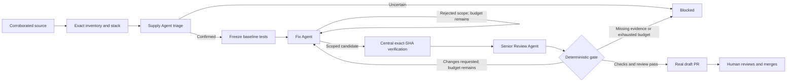

# Three agents, one generic LangGraph workflow

Implementation status: **25 October 2026 (Asia/Calcutta)**. The service detects each repository's supported stack and tests. Repository owner/name allowlists do not select the repair policy. A single dashboard explains the journey and exposes actual LangChain/Groq calls, LangGraph state, checks, diffs and draft PRs.

| Agent | Responsibility | Model and authority |
|---|---|---|
| Supply Chain | Triage new unconfirmed forum leads and explain corroborated package/image matches | `openai/gpt-oss-20b` through `ChatGroq`. Read-only structured output. A post alone cannot establish a confirmed finding. |
| Fix | Propose the selected dependency or image update inside the discovered deterministic policy | `openai/gpt-oss-120b`. The controller validates edits before branch writes. The agent cannot change tests/workflows or invent lock integrity metadata. |
| Senior Review / DevSec | Review the actual candidate change and observed test evidence in a separate context | `openai/gpt-oss-120b`. Can request changes or approve a draft packet, but cannot override failed checks. |

The controller owns adapters, scope, budgets, cancellation, provenance and publication. The central GitHub Actions runner executes checks. A human owns merge and deployment. These are separate authorities, not extra model agents. Using the same larger model in two contexts is not independent-model assurance.

## Detect the stack and exact repair capability

The registry reads immutable default-branch manifests, repository permissions and baseline test inputs. It advertises supported targets as exact ecosystem/package/manifest triples. A tested Python service in a monorepo does not grant permission to repair an untested Python manifest elsewhere.

| Adapter | Detected inputs | Permitted changes and execution |
|---|---|---|
| PyPI | Stable exact requirements pins and conventional unittest/pytest tests, or the existing business-check script | Change the selected exact pin. Download binary wheels without application source, then run frozen tests against the candidate package. |
| npm | Direct dependency in package.json, committed package-lock.json and meaningful test files/script | Change the direct constraint. Resolve the lock with the real package manager without install hooks. Verify the final committed lock and frozen tests. |
| Composer | Direct dependency, composer.json/composer.lock and a supported PHP test suite | Change the direct constraint. Resolve the lock without plugins/scripts, then verify installed version and baseline tests. |
| Containers | Official nginx/PHP image references in Dockerfile or Compose YAML, supported vendor evidence and runtime oracles | Replace only the matching image reference with a verified version and digest. Scan images and run the fixed image's relevant behavior checks. |

New supported public connections enable automatic draft preparation by default. Existing settings survive reconnect. Unknown stacks, missing/empty suites, unsupported requirements, transitive-only package changes and unsupported image smoke policies remain explicit boundaries. Private generic repair is unavailable because the central runner currently checks out public code anonymously. A separately configured isolated checkout credential is required before that boundary can change.

## Watch sources independently of repair jobs

A separate worker checks enabled repositories every 300 seconds by default. Manual scans queue work immediately. Up to 1,000 exact dependencies are inventoried per repository, with OSV query batches of at most 100. Tree, file and verification-context reads are bounded. Truncation and source errors cannot become clean scan results.

Allowlisted forum leads receive bounded read-only Groq triage. Triaged IDs persist so unchanged posts do not repeatedly invoke the model. The leads remain unconfirmed. Package findings use exact OSV matches and published registry metadata, followed by another OSV query of candidate versions. Supported image findings use vendor-version mappings and published Docker image digests. A missing verified target becomes owner work.

Findings for the same repository, package/image, manifest, installed version and exact replacement share a repair run and PR. Image digest identity is part of that grouping. The UI keeps every advisory match in an expandable evidence list.

## Traverse the actual ten-node graph

`apps/api/src/graphs/security-graph.ts` compiles the shared `StateGraph`.

The nodes are `source`, `inventory`, `triage`, `baseline`, `repair`, `verify`, `review`, `gate`, `publish` and `blocked`. The controller permits at most two candidate attempts, five role calls and 16 minutes per run. Verification exceptions fail closed. A model cannot turn missing execution into a pass.

SQLite checkpoints correlate graph history with run/events. Expired worker leases fail closed. Checkpoints do not currently provide automatic crash resume or side-effect replay.

## Use the central verifier without installing target workflows

The trusted workflow is `.github/workflows/repository-repair.yml` in `Harsh5840/arigato-hack`. Target repositories need no custom ProofPatch workflow. The controller freezes the central runner SHA separately from the target's base and candidate SHA.

For npm and Composer, a preparation dispatch resolves the lockfile with the package manager. Its artifact binds generated lock bytes to the preparation run, target repository, base/candidate/central-workflow identities and frozen test digest. The controller commits the validated lock, then dispatches full verification for the final candidate SHA. A successful preparation pass does not authorize a PR.

The five required final runner gates are `scope`, `verifier`, `package_version`, `business_suite` and `no_known_advisories`. The controller also checks artifact schema, trusted-workflow success and exact evidence identity. Empty tests cannot pass. Package downloads do not receive application source, hooks or credentials. Application tests run in a non-root, read-only, resource-bounded container without external network or a Docker socket.

Container verification performs real Trivy scans of the affected image and digest-pinned candidate. The affected image is never executed. Supported vendor sources independently corroborate the selected CVEs and replacement version. Selected CVEs still reported in the candidate block publication. Residual OS/package findings and scanner coverage gaps remain visible for the owner; the system does not claim an image has no vulnerabilities.

## Bind evidence to publication

Shared contracts are in `packages/contracts/src/live.ts` and `monitoring.ts`.

| Record | Bound identities |
|---|---|
| Repository capability | Verified access, inventory SHA, stack, test command and exact supported package/manifest targets |
| Finding | Repository, ecosystem/name/version/manifest, advisory aliases, published target and optional image digest |
| Candidate | Direct baseline parent, scoped modified files, candidate SHA and controlled branch |
| Final verification | Target repository, base/candidate/central-workflow SHA, run ID, Actions ID, frozen verifier hash and artifact digest |
| Draft PR | Same verified branch/head, actual CI link, source evidence, bilingual rationale, rollback and owner tasks |

Branches are never force-pushed. Existing writes are reused only when identity and content agree. A changed default branch, moved candidate, failing/missing assertion, malformed artifact or cancellation prevents successful promotion. External writes already in flight cannot be atomically revoked; their returned state stays recorded. Draft creation leaves `mergeReady` and `findingClosed` false.

## Demonstrate three repositories

- [PHP storefront](https://github.com/Harsh5840/arigato-php-demo): generic PHP Docker image update and 15 frozen Japanese storefront assertions. INI, startup/web configuration and incident follow-up remain mandatory human tasks. Earlier multi-file runtime/configuration repairs retain their historical provenance.
- [Python service](https://github.com/Harsh5840/arigato-python-demo): Requests pin update and 12 business assertions for Japanese content, JPY totals and client behavior.
- [Container service](https://github.com/Harsh5840/arigato-container-demo): one Compose YAML image reference update and seven live HTTP smoke checks of the Japanese storefront.

The generic central path completed Python run `85a102f8-c69a-424d-8f0d-8a5b653bf816`, creating [PR #2](https://github.com/Harsh5840/arigato-python-demo/pull/2) after [12 business assertions passed](https://github.com/Harsh5840/arigato-hack/actions/runs/40128567277). Container run `1159357a-7e93-4c2d-ab11-efa91a56aa59` created [PR #1](https://github.com/Harsh5840/arigato-container-demo/pull/1) after [seven live HTTP assertions and 11 controller/runner gates passed](https://github.com/Harsh5840/arigato-hack/actions/runs/40128986019). PHP run `00cd66dd-c269-4b93-83a3-c690fb8f8932` created [PR #6](https://github.com/Harsh5840/arigato-php-demo/pull/6) after [15 storefront assertions and 11 controller/runner gates passed](https://github.com/Harsh5840/arigato-hack/actions/runs/40129110636) with runtime PHP 8.3.36. The PHP change updates the Dockerfile image only and retains configuration/deployment/incident follow-up. Historical fixture-specific PRs retain their own provenance.

The Compose change upgrades nginx 1.26.0 → 1.30.6 with a digest. Trivy retained 391 candidate findings across all severities, compared with 831 baseline findings. These residuals remain human follow-up rather than a clean-image claim.

The primary visual explanation is **Connect & inspect → Watch for alerts → Confirm the risk → Prepare the update → Test & review → You review the PR**. Technical React Flow handoffs, model calls, checks and events remain expandable on that same screen.

## Keep extension claims bounded

A new ecosystem needs exact inventory/source adapters, deterministic edit scope, real package resolution and relevant frozen tests. Arbitrary code migration and exploit reproduction require more work than a generic graph. Local-file pentesting, GitHub App onboarding, tenant identity, signed webhook ingestion, horizontal workers, private runner checkout and automatic crash recovery remain future work. No X connector or fault-proof guarantee is claimed.

Framework references: [LangGraph](https://docs.langchain.com/oss/javascript/langgraph/overview), [LangChain ChatGroq](https://docs.langchain.com/oss/javascript/integrations/chat/groq), [OSV API](https://google.github.io/osv.dev/api/). These describe underlying libraries/services. ProofPatch execution claims require actual run evidence in [the demo guide](LIVE-DEMO.md).
