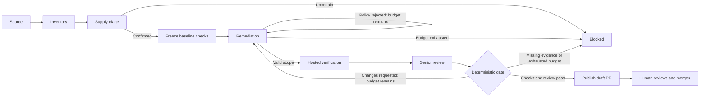

# Three agents, one LangGraph workflow

Implementation status: **25 October 2026 (Asia/Calcutta)**. These are actual server-side LangChain/Groq roles and LangGraph transitions, visualized in the single dashboard. Earlier synthetic prototype traces remain historical assets.

| Role | Actual responsibility | Model and authority |
|---|---|---|
| Supply Chain Agent | Triage new unconfirmed forum leads; explain corroborated advisory/package/version matches for registered repositories | `openai/gpt-oss-20b` through `ChatGroq`; read-only structured responses. Cannot establish a confirmed finding from a post alone. |
| Remediation Agent | Propose complete file contents inside a maintainer-approved repair policy, explain compatibility/rollback/owner tasks | `openai/gpt-oss-120b`; controller validates output before candidate writes. Cannot change trusted tests/workflows or merge. |
| Senior Review / DevSec Agent | Review the actual candidate diff and observed frozen-check evidence; approve a draft review packet or request changes | Separate `openai/gpt-oss-120b` context; cannot override failed deterministic checks. This is not independent-model assurance. |

The deterministic controller owns network/GitHub adapters, scope, budgets, cancellation, evidence validation and publication. The GitHub-hosted runner executes frozen checks. The human owns merge and deployment. These are separate authorities, not additional model agents.

## Repository watch before orchestration

A separate worker checks approved feeds and registered repository inventories every 300 seconds by default. New forum leads receive bounded read-only Groq triage; triaged IDs are persisted so unchanged leads do not repeatedly invoke the model. Posts remain unconfirmed. Exact ecosystem/package/version OSV queries establish findings independently of the scout's opinion. Source errors and unsupported inventory remain visible.

Inventory adapters currently support exact PyPI requirements, npm package-lock and Packagist Composer lock entries, including nested manifests. Published candidate releases are checked against registry metadata, restricted to the installed major, and queried against OSV again. A missing supported fix becomes owner work. This selection does not prove application compatibility; the approved runner and human review address that separately.

Registered repositories normally remain monitor-only. The owned Python Requests fixture has an enabled repair policy. Several corroborated advisories for the same package/version/target share one run and draft. The PHP fixture retains its separate manually initiated Japanese runtime-advisory policy.

## The actual ten-node graph

`apps/api/src/graphs/security-graph.ts` compiles a real `StateGraph`, with profile-specific node implementations supplying work while sharing the graph edges.

The ten nodes are `source`, `inventory`, `triage`, `baseline`, `repair`, `verify`, `review`, `gate`, `publish`, `blocked`. Verification exceptions fail closed; a green model response cannot manufacture passing execution. The repair policy and senior-review routes allow at most two candidates and five role calls per run. The overall limit is 16 minutes. Monitoring scout calls are separate from that repair budget.

SQLite checkpoints preserve graph state/history and correlate a graph thread with the persisted run/events. Current worker-loss behavior fails an expired lease closed. Automatic crash resume and replay of GitHub side effects are not implemented merely because a checkpointer exists.

## Typed boundaries and evidence

Shared contracts live in `packages/contracts/src/live.ts` and `monitoring.ts`.

| Record | Important identities and meaning |
|---|---|
| Registered repository | Server-verified owner/name/default branch, immutable inventory SHA, supported dependencies, push capability, watch toggle and policy profile |
| Unconfirmed lead | Approved feed, URL, title, retrieval/publication times, aliases and unconfirmed trust label |
| Corroborated finding | Repository, exact ecosystem/name/version/manifest, advisory ID/aliases, registry-verified target and source links |
| Candidate | Direct parent baseline, candidate SHA, controlled branch and scoped complete file contents |
| Frozen verification | Unchanged oracle SHA256, exact base/candidate/workflow/run identities, actual check assertions and runtime/business output |
| Draft handoff | Same verified candidate head, actual CI link, bilingual rationale/review, rollback notes and human tasks |

Candidate branches are never force-pushed. Existing writes are reconciled only when identities/content agree. Publication checks both the branch and returned PR head against the verified SHA. A changed main, malformed artifact, failed/missing required check, cancellation or exhausted budget prevents successful promotion. An external write already in flight cannot be atomically revoked; its returned state remains auditable.

## Current repair policies

**Python Requests:** `Harsh5840/arigato-python-demo` deliberately declares affected Requests 2.31.0. The controller selects a published same-major OSV-clean release, 2.34.2 at the current scan. The reviewed policy changes only its exact pin and preserves `service/client.py`; code compatibility edits need a future approved policy. Frozen CI checks scope, unchanged verifier, actual package/Python version, 12 Japanese business assertions and OSV matches for actual installed application dependencies. It runs only the candidate, isolated from network and credentials.

**Japanese PHP runtime:** `Harsh5840/arigato-php-demo` deliberately declares PHP 8.3.35. Its retained policy corroborates the Japanese/vendor notices, updates the reviewed 8.3.36 image/digest, Composer PHP floor and startup upload-progress mitigation. Frozen hosted checks cover runtime/configuration and 15 Japanese storefront business assertions. This runtime-advisory policy differs from Composer package matching; it is not a generic PHP-discovery adapter.

Both baselines are classified statically, never installed/executed as part of the demo. A manifest advisory match establishes affected inventory, not exploit reproduction or deployed exposure. Passing behavior is not proof of complete security. Draft publication leaves `mergeReady` and `findingClosed` false.

## What the dashboard explains

The plain-language journey is **Connect repository → Watch security news → Find affected package → Prepare a fix → Test & senior review → Draft PR → human**. The expanded React Flow shows technical handoffs, actual stage state and model calls. Repository controls, source health, findings, real diff/checks, events and observed analytics share the same screen. No invented posture score or synthetic organization metrics are required.

## Extension path

Add an exact inventory adapter and trusted source mapping for a new ecosystem. Add a maintainer-approved repair profile defining allowed edits, compatibility expectations, frozen verifier, runner isolation and required evidence IDs. Supply those operations to the shared graph rather than copying a new orchestration engine. Framework migration and lockfile/code rewriting require policy and tests; a generic graph alone does not implement every language's repair semantics.

Local Git/file-triggered pentesting, arbitrary code edits, exploit reproduction, GitHub App onboarding, multi-tenant identity, webhook ingestion, horizontal workers and automatic crash recovery remain later work. No X connector is installed. Do not call the product fault-proof.

Framework references: [LangGraph overview](https://docs.langchain.com/oss/javascript/langgraph/overview), [LangChain ChatGroq](https://docs.langchain.com/oss/javascript/integrations/chat/groq), [OSV API](https://google.github.io/osv.dev/api/). These document the underlying libraries/services; ProofPatch's specific execution claims require the linked actual run evidence in [the handoff](IMPLEMENTATION-HANDOFF.md).
